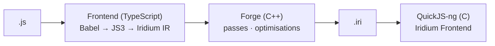

# Iridium

**Iridium** is a static analysis framework for JavaScript.

This started out as passion project which over time has slowly become more and more usable.

This is a research/passion project that has over the years become the main part of my PhD,

Much love and learning has gone into this project, though it may not be 

Static analysis of JavaScript remains notoriously difficult due to the language’s dynamically typed nature,
unconventional scoping rules, and pervasive side effects. Unlike mature infrastructures such as LLVM for C/C++
or Soot for Java, comparable frameworks for JavaScript are fragmented and limited in scope. IRIDIUM is a static 
framework designed for analysis as-well-as target code generation. IRIDIUM systematically lowers JavaScript into 
a structured intermediate representation (called IRI) that models bindings,
environments, and control flow explicitly. The resultant expressiveness enables more predictable analyses and
transformations, ranging from dataflow tracking to optimization passes to executable code generation for
existing runtimes, that are otherwise hindered by the language’s complexity. By bridging the gap between
JavaScript’s surface syntax and the requirements of static analysis, IRIDIUM, thus, lays the foundation for a
new generation of tools that can reason effectively about modern JavaScript applications.

!!! note "Work in progress"
    This site is under construction. Most pages are stubs for now.

Iridium is built from three components:

| Component | Language | Location |
|---|---|---|
| Frontend | TypeScript | this repository |
| Forge (analysis) | C++ | `externalDeps/Iridium-Forge` |
| Runtime | C | `externalDeps/quickjs` |

## Where to next

- [Installation](getting-started/installation.md)
- [Quickstart](getting-started/quickstart.md)
- [Architecture](concepts/architecture.md)
- [Contributing](contributing.md)
